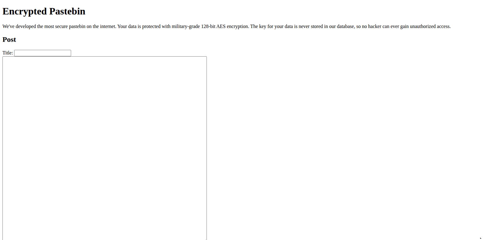
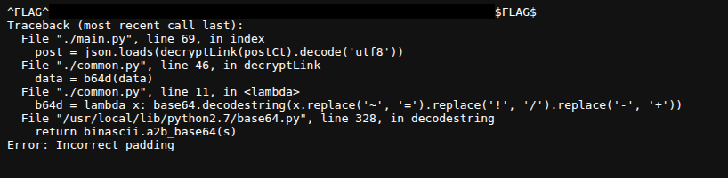
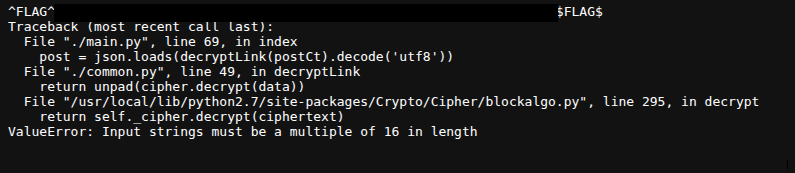
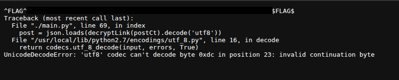
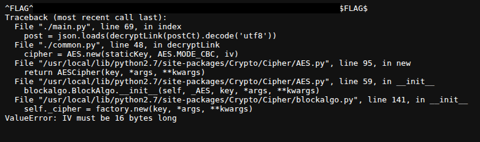
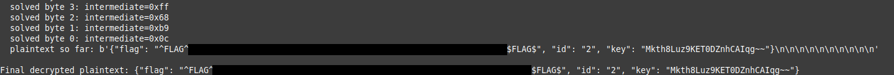
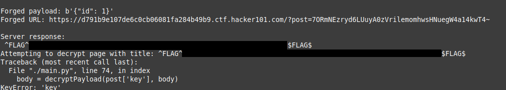
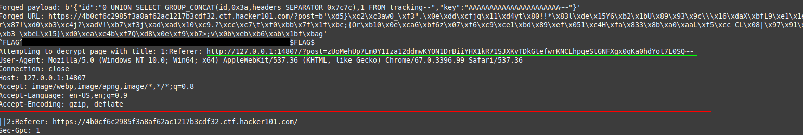
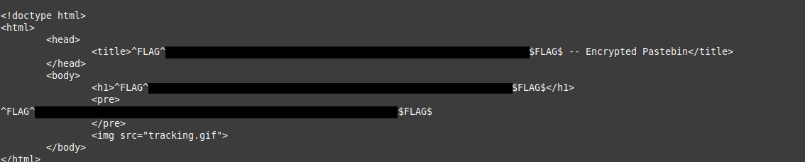

## Challenge: Encrypted Pastebin by Hacker101
## Difficulty: Hard
## Category: Web, Crypto



This is one of those challenges that asks you: *how patient are you?
And how much theory do you actually know?* . The landing page hints at
the encryption method right away, **128-bit AES encryption**, and
makes a bold claim: the key is never stored on their server.

That raised an obvious question: if the key isn't stored server-side,
how is decryption happening at all? My first guess was that it must
be stored client-side somehow, sent along with every request. But
after digging through the network traffic multiple times, I never
caught anything resembling a key being sent, no cookie, no hidden
field, no header. Whatever "the key is never stored" actually meant,
it wasn't as simple as it sounded.

## Failed Attempt

I found one particular file interesting though, a file named
`tracking.gif`. I thought it might possibly be logging activity
and could contain important information.
I downloaded it to check if there were any secrets hidden in its
metadata. But after multiple trials, it amounted to nothing.

## Flag0
I filled the input field and submitted it, and it redirected me to an
obviously encoded URL.
``
*ctf.hacker101.com/?post=<BLOB>
``

I changed the value of the encrypted blob at multiple positions and
got a number of errors on each modification plus Flag0.
I also tried it with an empty argument and got another error.

> **Note:** Flags below are numbered by the order I discovered them.

## Discussing Errors And Exploit Path

The errors, which i'm about to discuss, exposed some of the internal logic of
the server. From these errors, I formed a blueprint for the next
flags.

### **Incorrect Padding Error:**



When a form is submitted, the padding of the encoded url was checked and unpadded.
If the padding is incorrect, this error is thrown. The error
reveals critical logic in decoding the URL:

The elements in the url are parsed into different symbols.

‘~’ ---> ‘=’ 

‘!’ ---> ‘/’

‘-’ ---> ‘+’

This error also reveals the use of JSON in the encoding.

### **Ciphertext ValueError:**


This error shows that the length of the
ciphertext must be a multiple of 16.

### **UTF-8 Decode Error:**



This error occurred because, after changing that byte, the resulting
byte at that position had no valid UTF-8 decoding.
Importantly, this error only occurs *after* AES decryption and
padding validation both succeed, thus, it signals that the padding
was valid, distinguishing it from a `PaddingException`. This
distinction is what makes the error usable as a ***Padding Oracle***.

### **IV ValueError:**


This error reveals the encryption logic used:
`AES.new(staticKey, AES.MODE_CBC, iv)`.
This confirms the cipher mode is AES-CBC, and that
a single static key is shared across every post rather than a unique
key per post.

### How the Padding Oracle Works

The server decrypts every post with AES-CBC using one static key, then
checks whether the decrypted bytes have valid PKCS7 padding before
trying to parse them as JSON. Critically, it returns a **different
error depending on where decryption fails**:

- Invalid padding → `PaddingException`
- Valid padding, but the bytes aren't valid UTF-8 / JSON → `UnicodeDecodeError` / `ValueError`

That distinction is the Padding Oracle: by tampering with the
ciphertext and watching which error comes back, we learn whether our
tampering kept the padding valid without ever knowing the encryption
key.

#### Why this works

In AES-CBC, each plaintext block is produced like this:

plaintext_block = AES_decrypt(ciphertext_block) XOR previous_block

`previous_block` is just the ciphertext block before it (or the IV,
for the first block). Since XOR happens *after* AES decryption, we can
substitute our own fake "previous block" — the server will still run
the same AES_decrypt step, just XOR the result with our bytes instead
of the real ones.

### Recovering one byte

To find the last byte of a block's plaintext:

1. Replace the last byte of the previous block with a guess, `0x00`–`0xFF`.
2. Send the request.
3. If the server reports **valid padding**, our guess made the result end
   in `0x01` — valid PKCS7 padding for 1 padding byte.
4. Since `guess XOR intermediate_byte = 0x01`, we solve:

intermediate_byte = guess XOR 0x01

5. XOR that `intermediate_byte` with the **real** previous block to get
   the real plaintext byte.

Repeating this for each byte position (forcing padding `0x02 0x02`,
then `0x03 0x03 0x03`, and so on) recovers an entire block, one byte
at a time — without ever touching the key. Moving to the previous
block and repeating decrypts the whole ciphertext.

### Script
Based on this logic, I created `./scripts/solver.py` to automate the exploit.
To use `solver.py`, all you have to do is replace the BASE_URL and BLOB
with your actual values.

## Flag2
The second flag I found was Flag2. I decrypted the blob using the Padding
Oracle attack. It returned a JSON object with `flag`, `id`, and `key` fields.

Run using:

```bash
python ./scripts/solver.py decrypt
```


### Forging ciphertext (the reverse direction)

The same logic runs backward: instead of solving for plaintext
given a known previous block, we *choose* the plaintext we want and
solve for what the previous block must be:

previous_block = intermediate_block XOR desired_plaintext_block

Chaining this block-by-block, right to left, lets us construct a
brand-new ciphertext (and IV) that decrypts to **any JSON we choose**.

## Flag1
After seeing the format of the JSON from Flag2, I decided to craft my own to
see if the server would be able to decrypt it. The JSON format was something
like this (placeholder values shown for illustration):
```JSON
{
"id": "1",
"key": "AAAAAAAAAAAAAAAAAAAAAA~~"
}
```
As a quick first test, I tried with only the `id` field, to confirm forging
worked at all before adding the rest.

Run using:

```bash
python ./scripts/solver.py forge
```


## Flag3
The server was prone to SQL injection. The JSON fields were being
taken raw as they were and passed without proper sanitization, so I
crafted my SQL payload around it.
After sending a few payloads, I discovered there was a table under the name
`tracking`. This brought me back to my initial failed attempt, the
`tracking.gif` file, it did log all the activity from everyone who visits
the host and stored in the `tracking` table.

> **Note:** The current payload points straight to the `tracking` table
>and dumps its content. I sent some earlier payloads before identifying
>that table, but for simplicity, I did not add them to the script.

Here are some of them:
```python
test_payload1 = b'{"id": "2 OR 1=1", "key": "AAAAAAAAAAAAAAAAAAAAAA~~"}'
test_payload2 = b'{"id": "2 OR 1=2", "key": "AAAAAAAAAAAAAAAAAAAAAA~~"}'
test_payload3 = b'{"id": "0 UNION SELECT table_name, 1 FROM information_schema.tables WHERE table_schema=database()-- ", "key": "AAAAAAAAAAAAAAAAAAAAAA~~"}'
```
Run the main payload using:
```bash
python ./scripts/solver.py sql_attack
```
After running the script, I saw a request made internally within the
server, from `http://127.0.0.1`. I copied that URL and curled it,
and voila, there was my final flag.



After curling to the url



## Final Takeaway

One of the biggest things I learnt from this challenge was that 
patience is key. I had to run most of my scripts over-night 
because they were taking way too long. And some of the painful 
aspect was that after assuming the script is still running, I
would come back to face a harsh reality of it terminating due 
to a whole load of errors, such as Level not found(404), Service 
unavailable(503) and some other network issues, leading me to 
start all over again.

This challenge really taught me why I have to keep learning new 
concepts.From this challenge, I was able to learn how to forge 
ciphertext for any plaintext by using the Padding Oracle attack.

To understand the attack better, you can check out [this article](https://www.nccgroup.com/research/cryptopals-exploiting-cbc-padding-oracles/)
by Eli Sohl.
Also, remember that each error you get is an eye-opener to the possibility of
a bug. If you are not sure where to find the flag, just break stuff. The
flags will show themselves.
